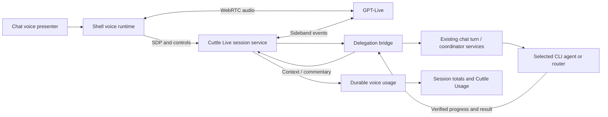

# GPT-Live integration: audit and implementation plan

Date: 2026-10-12. Chat: CH-001273. Branch: `dev`.

Status: implemented in the working tree on 2026-10-12; activation requires the usual Flask restart and refreshed UI. Android's new native transport requires the rebuilt APK. Automated provider and browser checks are isolated; real model access, microphone behavior and physical-device audio remain smoke-test checks. The audit below records the pre-implementation findings and the design decisions they motivated.

## Intended product behavior

GPT-Live should be the recommended conversational voice engine. OpenAI Realtime and the established transcription + TTS path remain selectable alternatives. Voice conversation should use the current chat's Cuttle agent, project, model, effort, router, steering, queue, confirmations, and cancellation semantics.

The connection must survive switching to a different Space or replacing a chat pane. Returning to the original chat must restore its voice presentation. Usage must be durable and visible below relevant message bubbles, below the composer, in the voice view, and through the existing Cuttle Usage dashboard. Android support includes the app's LAN HTTP configuration, not only browser WebRTC on a secure origin.

## 1. Sanity check of the current implementation

| Finding | Evidence in the working tree | Required correction |
| --- | --- | --- |
| GPT-Live is absent | `api.voice_realtime` calls `sdk.realtime.client_secrets.create`; `chat_voice_realtime.js` connects to `/v1/realtime/calls`. No `gpt-live-1` configuration or Live event handling exists. | Add a distinct Live adapter and session lifecycle. Changing a model string is insufficient. |
| The settings mode selector edits configuration | `settings_voice_providers.js::changeMode` hides/shows sections; `chat_voice.js::enter` selects Realtime whenever its experimental flag and browser capabilities permit it. | Persist the actual conversation engine separately from feature availability and the settings editor's selected section. |
| Cross-Space voice continuity remains incomplete | `shell_panes.js::navigate` skips replacement only for the same existing chat. `app_shell.js::applyWorkspaceColumns` discards other panes. The voice connection is owned by the disposable chat document. | Move connection ownership to a shell lifetime, with chat views attaching as presenters. |
| Voice overlay restoration does not restore a call | Per-chat sessionStorage remembers whether voice mode was open. A replacement page creates new runtime state and resets `realtimeUsage`. | Distinguish persisted view preference from a live connection and durable accumulated usage. |
| Composer totals omit the new voice usage | `auth_db.py::get_assistant_usage_metadata` reads only saved assistant `metadata.usage`; `chat_page.js::updateSessionUsageSummary` sums those entries. No voice ledger merge exists. | Add one authoritative session usage service used by all usage surfaces. |
| Voice overlay totals are partial | The overlay sums currently mounted assistant DOM nodes plus an in-memory Realtime accumulator. Older paginated messages, prior connections, STT, and some narration are excluded. | Read durable totals, then apply identified pending updates without counting them twice. |
| Voice calls lack chat/message attribution | Realtime usage forwarding omits `session_id`. STT and TTS calls also omit chat IDs at their provider-service seams. | Bind every metered call to an authorized chat and, where applicable, a message/turn. |
| Realtime usage reporting can lose or duplicate cost | `flush` advances sent indexes before a reporting request succeeds; server recording is append-only with no event/session identity. | Add acknowledgments, retries, provider event receipts, and transactional idempotency. Prefer provider events observed by a server connection. |
| Transcription pricing ignores the selected model | `price_realtime_payload` hardcodes `gpt-4o-mini-transcribe`. `aggregate_transcriptions` ignores duration usage. Installed SDK types support both token and duration variants. | Freeze the actual transcription model in the server session and support both usage forms. |
| Bubble TTS cost is not integrated consistently | The bubble speaker path ignores returned usage; the overlay path stores it only on the DOM. A server cache hit still returns the synthesis estimate as though another synthesis occurred. | Share the speech result path, persist attribution, and count only new billable calls. A fresh summarization call can still cost money on an audio-cache hit. |
| Unsupported voices can remain selectable | TTS discovery filters the provider list, but `options` re-adds an unavailable saved voice as an unverified option. Realtime settings accept arbitrary model/voice strings. | Separate unsupported saved values from selectable supported choices; validate built-in model/voice combinations on save and startup. Keep provider custom-voice workflows explicit. |
| Android is conditional | Realtime requires `getUserMedia`. The native `NativeMic` implementation supplies 16 kHz phrase WAVs for STT and is not a streaming WebRTC track. The app loads remote HTTP or HTTPS pages. | Verify WebRTC on the actual secure WebView and add native continuous audio transport for HTTP app sessions. |
| Experimental gating is only partly proven | The rail now filters Test Lab by `test_lab`; its operation routes check the flag. Its direct HTML route still serves the page while disabled. Voice explanatory text is static, and Realtime settings/usage routes have no feature check. | Check every launch surface and direct page. Prevent new disabled sessions while still allowing existing sessions to close and record final usage. |
| Pending agent results are loosely correlated | Current voice delegation reads the latest assistant DOM node; steering uses one boolean, and queued follow-ups have no automatic voice-result correlation. | Map each delegation to a stable Cuttle turn/follow-up identity and return that operation's result. |

The TTS facade's `gpt-4o-mini-tts` rate of `$12/1M characters` is an application approximation, not its published billing unit. Official pricing lists text input tokens and audio output tokens. Verify or replace the approximation using reported usage or a documented audio-duration estimate; retain an explicit estimate marker. [OpenAI model pricing](https://developers.openai.com/api/docs/models/gpt-4o-mini-tts)

Focused verification performed:

```bash
PYTHONPATH=src .venv/bin/python -m pytest \
  src/tests/chat/test_voice_realtime.py \
  src/tests/chat/test_voice_usage.py \
  src/tests/chat/test_chat_voice_overlay.py \
  src/tests/shell/test_pane_lifecycle.py -q
```

Result: **44 passed in 2.63s**. These are isolated/mock checks of the existing implementation. They do not establish real Live access, actual microphone behavior, cross-Space continuity, or the missing usage integration. No paid provider call or real agent CLI was invoked. Installed OpenAI SDK: `3.26.0`; Live creation and sideband resources are present.

## 2. Verified API constraints

The API model catalog documents `gpt-live-1`, priced at `$0.05/minute`, billed per second. The API availability and pricing of `gpt-live-1-mini` were not established by the reviewed official sources. Do not expose an invented Mini API option. Medium/High should describe a supported backend model's effort, rather than separate Live voice models. [GPT-Live model](https://developers.openai.com/api/docs/models/gpt-live-1)

Browser setup uses a server-side `POST /v1/live/sessions` with a JSON session configuration and WebRTC SDP offer. Apply the returned SDP answer and wait for `session.started`. It uses neither the existing Realtime ephemeral-token flow nor Realtime event names. [WebRTC guide](https://developers.openai.com/api/docs/guides/voice-webrtc)

Client delegation is supported for an existing agent/harness. The delegation event supplies an ID and metadata, not a complete task prompt. Transcript deltas must be assembled with application context. Return speakable results with `session.commentary.append`, quiet context with `session.thinking.append`, and respect the 500-token limit per append. [Delegation guide](https://developers.openai.com/api/docs/guides/live-delegation)

A server sideband attaches to `wss://api.openai.com/v1/live/sessions/{session_id}/attach`. One connection must own delegation execution and usage writes, even when both browser and server observe the same events. Restrict frontend data-channel permissions at startup so it cannot submit arbitrary trusted instructions or backend results. [Server controls](https://developers.openai.com/api/docs/guides/voice-server-controls), [session schema](https://developers.openai.com/api/reference/resources/live/methods/create)

Active duration includes speech, silence, and backend waiting. WebRTC creation bills 15 seconds during initialization, credited against running duration. This is not an extra 15 seconds on a completed running session. Do not repeatedly create sessions merely to populate a settings screen. Failed or abandoned initialization needs an explicitly marked accounting state until its billable outcome is known. [Cost guide](https://developers.openai.com/api/docs/guides/voice-latency-cost)

`session.usage.updated` reports cumulative seconds. Graceful shutdown sends `session.close` and waits for `session.closed` before releasing transports. Preserve the last observed usage and mark finalization unconfirmed if the final event never arrives. [Session lifecycle](https://developers.openai.com/api/docs/guides/live-conversations)

## 3. Architecture and ownership

Recommended default delegation: **GPT-Live → the chat's existing Cuttle agent**, using client delegation. Native Responses delegation is a later optional backend choice, not a prerequisite. It would need its own explicit model/effort selection, tool authorization, and billing integration.



| Owner | Responsibility |
| --- | --- |
| `api.model_providers.openai` | Provider credential access and the small Live SDK transport adapter; mode/model voice capability data. |
| New `api.voice_live` package | Session creation, attachment, close/recovery, chat binding, transcripts and delegation records. Keep service, transport, store, and route responsibilities clear within this cohesive owner. |
| `api.chat_turn`, `api.chat_coordinator`, `chat_delivery`, steering/follow-up owners | Agent selection, execution, busy/turn fencing, persistence, steering, queue and cancellation. Voice supplies a normal turn envelope through injected public interfaces. |
| `api.voice_usage` plus `api.model_providers.usage` | Pricing and durable receipts for usage. Extend the existing ledger rather than adding a parallel cost total. |
| `api.settings_routes` + settings manager | Validate and persist voice engine settings; delegate capability checks to the voice/provider owners. |
| New `shell_voice.js` over a shared voice session controller | One active audio connection per shell window, pinned to an authorized chat; survives chat iframe replacement. |
| `chat_voice.js` and a separate Live protocol controller | Existing overlay controls/presentation and Live event interpretation. Standalone chat uses the same controller with a document-lifetime host. |
| Usage presentation owner + `chat_usage.js` | Fetch authoritative totals and render voice duration, audio usage and cost without labeling Live duration as text tokens. |
| `apps/mobile/.../voice` | Native capture/playback transport when WebView WebRTC capture is unavailable. |

Composition roots receive thin wiring only. Owned modules never import `web_chat_api`. Existing dirty files remain intact during implementation; review their changes before editing. Runtime state resolves through `core.runtime_paths`; credentials stay in the existing provider owner. Keep provider storage off by default and resume from saved text/context without requiring cloud audio recordings.

### Proposed interfaces

Use an `api.voice_live.routes` blueprint for session transport, with naming finalized alongside existing API conventions:

- `POST /api/voice/live/sessions`: authorize chat, freeze engine/model/voice, validate SDP, create session, attach backend observer and return SDP answer plus an opaque Cuttle voice ID.
- `GET /api/voice/live/sessions/<id>`: authorized lifecycle/transcript/usage snapshot for presenter reattachment.
- `POST /api/voice/live/sessions/<id>/close`: idempotent graceful closure and final usage collection.
- Shared settings endpoints under `/api/settings/voice-chat` and a session usage endpoint owned by the usage service.

The client does not choose another user's chat, upload a provider session ID to take ownership, override trusted startup instructions, or select billing rates. Resolve those from the authenticated server binding. Bind new-chat voice to a real Cuttle session before the first charge. Generate a creation attempt ID; avoid blind SDK retries after an ambiguous paid session-creation timeout. Reconcile or clearly surface uncertain creation instead of silently creating multiple sessions.

Attach the sideband before returning ready state. Buffer and deduplicate any early events observed before attachment; otherwise a delegation can be missed at startup. The receiving loop must keep draining events while a Cuttle agent is busy; delegated execution runs independently through the existing coordinator.

## 4. Delegation, history, and interruption

Persist a mapping from `(voice_session_id, delegation_id)` to the authorized Cuttle chat, transcript range, task revision, turn/follow-up identity, and terminal status. Claim each delegation transactionally. Browser captions are observers; server delegation handling is the execution owner.

Assemble incremental user/assistant transcripts by timeline, retaining corrections and enough recent context for references such as “that change” or “yes.” Do not dispatch each delta as a new task. At delegation, use a bounded coherent transcript window plus relevant saved chat/project/task context. Account for transcript events arriving around the delegation boundary; ambiguous or incomplete requests should lead to clarification, not guessed commands.

Seed new connections with a bounded recent chat/context snapshot. Persist voice-only conversation records so reconnecting does not forget the exchange. Link delegated user speech to the user row already created by the ordinary chat path, and keep the authoritative agent reply as that turn's existing assistant row. Avoid duplicating that reply as another agent turn just because Live paraphrases it aloud. Mark voice companion transcripts separately from harness execution and actual spoken delivery.

Follow the existing selected-agent policy for new work. Capture the agent/model/effort selection used for each turn. Changes to the chat selection apply to later work; switching Space must not retarget the ongoing voice session to whichever chat is now visible.

While an agent runs, new actionable speech uses its supported steering path or the existing follow-up queue. Correlate eventual results to their operation, not to the latest bubble. Handle multiple pending delegations explicitly. A speech interruption changes audio delivery; it does not automatically cancel or resubmit project work. Explicit cancellation passes through the normal terminal cancellation path. A disconnected voice session may leave an agent turn running in chat, and late results must be available after reattachment without starting the action again.

Return verified facts and short results, filtering UI markup, command blocks and private reasoning. Chunk coherent results to the API append limit; do not arbitrarily truncate the last DOM bubble. Keep confirmation cards authoritative: a transcribed casual “yes” must not automatically click an unrelated confirmation card. Present pending approvals in chat and announce that they need attention.

Use task progress for short optional spoken updates and quiet context. The existing narrator/TTS pipeline should not run in parallel with Live and speak over it. Track playback separately from an agent's completion.

## 5. Settings, flags, and session lifetime

One Voice page should contain an actual **Conversation engine** preference and the relevant model/voice controls. Offer GPT-Live as recommended, Realtime as an alternative, and the established speech-input/TTS conversation path. Keep bubble read-aloud preferences clearly named, since they can be useful regardless of conversation engine.

Expose backend intelligence as “Uses this chat's agent/model/effort” for client delegation. Reuse the existing agent controls. Do not force an OpenAI reasoning API backend onto a chat that selected Claude, Codex, or another CLI. CLI subscription usage continues under that CLI's existing billing behavior; it is not automatically a new provider API token charge.

Add `voice_live` as a default-off experimental flag. Flags control availability; the saved engine controls selection. Hide disabled engine options, their controls and feature-specific explanatory text. Existing Realtime preferences remain valid; an explicit engine choice wins over flag precedence. For an unset preference, recommend Live when enabled and supported. Do not silently switch a saved engine or open a paid connection on page restore. Show saved unsupported choices as invalid, without offering them as verified voices.

Save validates model, voice and transcription model against the selected engine. Server creation validates again and freezes the rate/capability snapshot. Existing Realtime/transcription model choices do not apply to Live. Changing a startup-only model or voice applies on a new connection.

The shell connection remains bound to its original chat across Spaces and pane changes. Provide a compact persistent voice control with chat identity, listening/mute state, elapsed billable duration, cost and a return-to-chat action. Closing a chat pane detaches its presenter; closing/deleting the chat or ending the call explicitly stops the connection. Serialize handover when a user starts voice in another chat so two connections do not accidentally capture the same microphone.

Distinguish switching Spaces from backgrounding/locking the app. Foreground Space switches continue voice. The initial Android release pauses/closes voice when the app backgrounds or locks, preserving conversation and agent work for explicit resume. Background phone-call behavior would require a separate foreground microphone service design and device validation.

Choose an idle policy that considers microphone activity, playback, pending task work and user interaction. Initial recommendation: notify after two minutes of complete inactivity and close after a short visible grace period; never infer inactivity from missing transcript deltas alone. Allow an explicit continuous-session preference. Mute and Disconnect must have distinct labels because mute keeps billing active. Flag disable rejects new sessions and closes active sessions, while permitting final usage reconciliation.

Audit Test Lab's direct page gate as part of the previously requested experimental-surface cleanup. Preserve operational close/status paths necessary to finish existing work safely.

## 6. Usage and cost accounting

The provider ledger owns charge entries. Persist event identity, authorized user/chat, voice connection ID, operation/response ID, optional message/turn, modality details, quantity/unit, applied rate/version, measured-vs-estimated provenance, and finalization state. Add a unique receipt key through a migration and a public idempotent ledger write interface; retain old rows with unknown attribution rather than assigning guessed chats.

For Live, turn cumulative duration checkpoints into nonnegative increments using a transactional high-water mark per provider session. Duplicate, replayed and older checkpoints add nothing. Reconcile final duration on `session.closed`. Record the initialization charge state and apply its credit once; do not assume every failed request is chargeable, or stack an extra 15 seconds onto confirmed running usage. Resolve uncertain outcomes using available provider evidence and keep them marked incomplete.

Realtime meters actual modality usage and the frozen transcription model, including duration-shaped transcription events. Keep response and transcription receipts distinct even if their display costs are combined. Repair reporting retries without double charging the ledger. A server observer is preferred; if a transport only reports from the client, retain durable unacknowledged events and mark the provenance accordingly.

STT, TTS and narrator calls carry chat/message/turn identifiers at their existing provider-service boundaries. A local replay creates no new synthesis entry. A cache hit returns zero newly incurred synthesis cost; any newly run summary is accounted separately. Use actual token usage when available and clearly identify approximations when unavailable.

One session usage service merges the disjoint agent and voice records. Render the result on all surfaces:

| Surface | Display rule |
| --- | --- |
| Message footer | Agent usage and separately labeled attributed voice usage. Voice-only transcripts can carry voice usage without inventing an agent run. |
| Composer | Durable whole-chat totals, including unloaded history and prior voice connections; honor the existing sub-agent inclusion preference. |
| Voice view | Current connection duration/voice cost, associated agent activity, and durable chat total. Show incomplete finalization when needed. |
| Cuttle Usage | Retain the Voice filter; add Live operation coverage and useful engine/model/duration grouping. Count one connection as a connection, not one turn per metering event. |

Duration costs with no text tokens remain visible. Do not add all idle voice duration to every agent reply. Attribute billable intervals once; retain unattributed conversational/idle cost at the connection/chat level. Do not count the same provider receipt again through a copied message footer or backend response metadata. Separate paid API spend from estimated equivalent CLI cost where the existing dashboard distinguishes them. Unknown usage is never presented as a verified zero.

## 7. Android transport plan

On a secure WebView with working microphone permissions, use the same Live WebRTC flow as desktop. Validate actual WebView origin/security, media permission callbacks, speaker playback and app lifecycle; an HTTPS URL alone is insufficient proof. Capacitor's local `https://localhost` configuration does not make a remote LAN HTTP page secure.

For LAN HTTP app sessions, add a native continuous audio path rather than claiming the phrase recorder is compatible. Use native capture/playback and a Cuttle-authenticated streaming connection to the server; the server uses a primary Live WebSocket. The existing `flask-sock` dependency provides a potential Cuttle transport seam. Both transports feed the same session/delegation/usage owner.

Use a dedicated native audio class or extend the existing owner with an explicit streaming contract. The current 16 kHz WAV clips must become negotiated raw streaming frames, with resampling where needed. The documented Live WebSocket example uses mono PCM16 at 24 kHz. Add bounded queues, audio focus, echo handling, output interruption, sample/timeline tracking, headset routing and resource cleanup. Keep the provider key on the server. [Live WebSockets](https://developers.openai.com/api/docs/guides/voice-websockets)

Native mic denial, WebRTC failure, native transport failure and fallback are distinct states. If the user chooses Realtime on an HTTP app session, provide its corresponding native/server transport or clearly report that it is unavailable and offer the established path. Never label STT + TTS as a successful Live/Realtime connection.

Acceptance uses a real installed Android build on the user's supported connection modes. The existing mocked browser tests cannot replace this step.

## 8. Implementation sequence and acceptance gates

| Stage | Deliverable | Evidence required before advancing |
| --- | --- | --- |
| 1. Repair selection and accounting contracts | Actual engine preference; validated capabilities; chat/turn attribution; idempotent receipts; session usage service; legacy STT/TTS/Realtime gap fixes. | Engine choice controls runtime. Whisper duration is priced correctly. Cache replay adds no synthesis spend. Reload and paginated history retain totals across all usage surfaces. |
| 2. Implement Live session service | Provider adapter, WebRTC exchange, early sideband attachment, frozen configuration, close/finalization and experimental gates. | Official-shaped fake events drive startup, usage and closure; no key reaches frontend; disabled/non-owner calls cannot start sessions; duplicate creation does not silently create extra calls. |
| 3. Integrate client delegation | Transcript assembly, stable delegation/turn mapping, existing agent submit/steer/queue, progress and concise result return. | One request executes once. Interruptions do not duplicate work. Steered/queued replies return to the correct task. Cancellation and late results respect turn/session guards. Confirmations retain their existing controls. |
| 4. Move connection lifetime to shell | Shell voice owner, chat presenters, persistent controls, standalone behavior and reattachment. | Different-chat Space A→B→A and multi-pane reconstruction preserve the connection; voice stays bound to A; no second microphone; returning restores its view and totals. |
| 5. Complete Android transport | Secure-origin WebRTC plus native streaming for LAN HTTP, playback/focus/permission handling. | Physical-device calls pass permission denial/regrant, duplex interruptions, Space switches, headset use, background/foreground, reconnect and final usage checks. |
| 6. Validate and roll out | Owner tests, browser integration checks, architecture fences, updated voice/experimental runbooks and deployment notes. | Deliberate real provider/microphone smoke test establishes access and audio behavior; spend agrees with measured duration and isolated backend usage within documented estimate limits. |

For stages 2–3, reject replayed events, mismatched chat/user IDs, malformed/oversized input, stale task revisions and out-of-order usage. Test loss of sideband, lost provider close event, failed ledger write and client reload. Test disabled flags on Settings, Apps, rail, direct pages and new-session APIs, including live flag changes.

Use fake providers and private `CUTTLE_HOME` for automated checks. Keep paid/audio/device smoke tests explicit. Validate startup/close ordering against installed SDK schemas rather than only source-string assertions. Update the dependency floor to the first SDK release actually validated for the selected Live interfaces and include its WebSocket extra when needed; the current environment's installed version is not proof of fresh-install coverage.

Application runtime stays unchanged during this planning turn. Future Python integration will require the documented user-selected graceful Flask restart after implementation; frontend-only presentation changes use the normal refresh path. Version bumps remain release-only.

## Plan completion and remaining proof

This document resolves the main architecture choices: Live is the primary intended engine, client delegation uses existing Cuttle execution, the shell owns audio across Spaces, and one durable accounting service feeds all usage surfaces. Responses delegation, API Live Mini, background Android calls, and provider recording/fork workflows are outside the initial implementation.

Automated checks now cover early sideband attachment contracts, transcript assembly and replay claims, initialization-charge reconciliation, finalization and failed ledger retries, safe shell reattachment, native HTTP setup, and persisted voice totals after reload. Real account/model access and physical Android duplex audio remain manual smoke tests.

## Implementation validation — 2026-10-12

- Combined owner, settings, provider usage, experimental compatibility, dashboard, architecture and browser suites: **358 passed, 1 skipped**. Subsequent focused checks cover the final usage presentation changes.
- `./gradlew :app:assembleDebug --offline`: **BUILD SUCCESSFUL**, with the native Live capture/playback bridge included. APK: `apps/mobile/android/app/build/outputs/apk/debug/app-debug.apk`.
- Browser tests exercise the actual Live controller with fake WebRTC/bridge transports, including HTTP secure-random fallback, terminal usage before teardown, duplicate transcript receipts, usage outbox recovery, and different-chat presenter reconstruction across Spaces.
- The shell owns the one active voice connection. The voice view displays the connection usage separately from whole-chat totals; message footers display attributed voice costs. Cuttle Usage includes the Voice filter and a duration metric.
- Realtime's browser-reported usage retains unacknowledged receipts in origin storage, retries after reload, and records idempotently under its server-bound connection. No audio or transcript text is stored in that retry queue.
- GPT-Live is off by default. Enable **Voice: GPT-Live** in Experimental after disabling its listed conflicts, then select GPT-Live in Voice settings. Python activation uses the normal restart card followed by a UI refresh. The phone requires the rebuilt APK.
- No paid OpenAI call, real agent execution, or physical microphone/device test was made. Native echo, headset routing and duplex interruption behavior still need a physical-device smoke test. Legacy `gpt-4o-mini-tts` cost remains an explicitly estimated character approximation rather than actual token billing.

## Follow-up — Realtime native Android transport (2026-10-12)

Stage 5's native audio path now covers **Realtime** as well as GPT-Live. The
Android app loads the UI over LAN HTTP, where the WebView is not a secure context
and cannot open a WebRTC peer connection or call `getUserMedia`, so selecting
Realtime previously reported "needs a secure connection or an updated Android
app". `api/voice_realtime/service.py` adds a server-owned OpenAI Realtime
**WebSocket** session: `POST /api/voice-stt/realtime/session` with
`transport: "native"` returns only an opaque voice id, the phone streams PCM over
`/api/voice-stt/realtime/sessions/<id>/socket` (same duplex code path as GPT-Live
via `LiveVoiceAudio("realtime")`), and the server translates the shared
`session.*` wire protocol, runs delegation/steering, and prices usage. The
`chat_voice_realtime.js` controller prefers the native bridge whenever a secure
WebRTC context is unavailable. Secure browsers keep the unchanged WebRTC path.
Tests: `src/tests/chat/test_voice_realtime_native.py`. Requires a rebuilt APK for
the `realtimeVoiceStart/Mute/Stop` bridge; a real account/device smoke test
remains.
